  
  
  
  

<!-- EDIT: gradient divider (self-hosted SVG) replaces the plain --- rules throughout -->

<!-- EDIT: refined QuizPup hero card, links to the live app -->

  
  
  

<!-- EDIT: stats card (stars, commits, release, last push, last commit message), auto-updated by .github/workflows/update-readme.yml -->
<!--QUIZPUP_STATS:START-->

<!--QUIZPUP_STATS:END-->

<h3>👋 About me</h3>

Data Science & Applications student at **IIT Madras (2024–2028)**, building full-stack apps solo and pushing toward machine learning and quant finance. I like building things that fix an annoyance I've actually run into myself, and I've gone deep into **backend security**, finding and fixing real vulnerabilities (IDOR, XSS, path traversal) in my own apps instead of shipping and hoping.

🎯 Looking for **backend / full-stack internships** &nbsp;·&nbsp; 🤝 Happy to collaborate on projects that try something new or are built from the ground up.

<!-- EDIT: QuizPup moved to the hero above, so this grid now shows the other three projects -->
<h3>🚧 More projects</h3>

<table>
<tr>
<td width="33%" valign="top">

#### 💼 [JobSwiper](https://github.com/ostadsanjoy/JobSwiper)
Job-search automation (FastAPI + React). Pulls listings from Greenhouse, Lever, Adzuna and Arbeitnow; Gemini tailors resumes and cover letters to a JD; LaTeX PDF resumes; Playwright auto-fills applications.

</td>
<td width="33%" valign="top">

#### 💸 [FinanceFusion](https://github.com/ostadsanjoy/FinanceFusion)
Personal finance tracker with per-user transactions, category budgets, and a dashboard with pie and bar spending breakdowns.

[🔗 Live app](https://financefusion-frontend.onrender.com/)

</td>
<td width="33%" valign="top">

#### ⬇️ [allinone-mediadownloader](https://github.com/ostadsanjoy/allinone-mediadownloader)
All-in-one media downloader tool.

</td>
</tr>
</table>

<b>🗄️ Past / on-hold projects (click to expand)</b>

 

**[Hospital Management System](https://github.com/ostadsanjoy/hospital-management-app)**: Flask + SQLAlchemy, hashed passwords, and a scheduling engine that splits doctors' hourly availability into 30-minute slots and prevents double-booking.

**[Placement Portal](https://github.com/ostadsanjoy/placement-portal-app)**: Three-role (Admin / Company / Student) placement system modeled on IITM's process, with a full OpenAPI 3.0 spec for every endpoint.

<b>📚 Currently learning (click to expand)</b>

 

- **Data & ML:** NumPy, Pandas, Matplotlib → scikit-learn → PyTorch, aiming for a deployed FastAPI + trained-model project
- **SQL:** moving beyond ORM-only queries
- **TypeScript:** converting an existing React project
- **AWS:** first deploy beyond Render/Heroku
- **Docker:** containerizing existing Flask apps

<h3>💻 Tech stack</h3>

**Languages** 

**Backend & Frontend** 

**Data, DB & DevOps** 

<h3>📊 GitHub activity</h3>

<picture>
  <source media="(prefers-color-scheme: dark)" srcset="https://raw.githubusercontent.com/24f2008057/24f2008057/output/github-snake-dark.svg">
  <source media="(prefers-color-scheme: light)" srcset="https://raw.githubusercontent.com/24f2008057/24f2008057/output/github-snake.svg">
  
</picture>

<!-- EDIT: recent activity moved below the streak and snake, auto-updated by the same workflow -->
<h4>🔨 Recent activity</h4>

<!--ACTIVITY:START-->
- 🔨 [`24f2008057/quizpup`](https://github.com/24f2008057/quizpup): pushed new commits · _2d ago_
- 🔨 [`24f2008057/24f2008057`](https://github.com/24f2008057/24f2008057): pushed new commits · _5d ago_
<!--ACTIVITY:END-->

💬 **Ask me about Flask, FastAPI, React, or app security**

